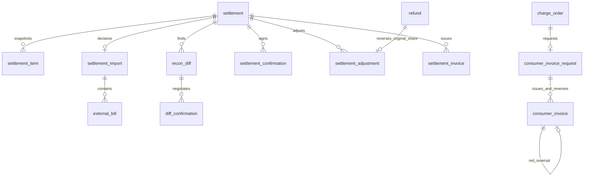

# 结算、对账和发票后端

本模块针对 MySQL 8.4，实现结算与用户发票的数据库闭环。第二版Flask API调用这些过程，网页已提供结算、导账、双方确认与票据操作；设备、支付及税务均为本地模拟。

## 业务口径与历史快照

- 订单开单时固定 station_id/operator_id；后续资产搬迁、场站变更运营商，均不改变旧订单及旧退款的归属。build_settlement(station,period) 根据历史运营商分别创建该站该月的结算单。
- 迟到首结不再限定“本月结束的订单”。截止账期末，已核价、足额收款且从未进入任何结算明细的订单，都可纳入当前草稿；source_period 保留原服务月份。旧账期已经确认时，迟到订单在下一草稿账期首结，不改旧账。
- 结算明细保存原订单折后、退款前金额及电费/服务费/平台费分配，不随当前价格、费用复核或资产归属动态重算。
- 起步价补足、正向复核差额归入服务收入；负向复核差额按原电费/服务费比例消减；优惠券再按比例分摊。电费运营商份额90%、服务费80%、平台费为折后原金额2%，净应结为两项分成减平台费。零计量但有起步收费的差额归服务收入，零元单不会生成零元支付或零元发票。

## 退款及撤销收款

正常减价退款只使用 refund.debt_reduction，逐笔逆向分配原结算明细。使用累计退款比例分别计算电费、服务费、平台费的累计冲回，再取相邻两次累计值之差，避免多次部分退款的舍入误差。原客户金额100元、电费运营商分成90元、平台费2元，原应结88元，全额退款只冲回88元，不能直接冲100元。退款在首次结算前发生时，仍以原分配正项加退款负项记账。

已确认账单不重写。跨期退款及迟到退款在当前草稿形成负调整，保留 refund_id、原 order_id、客户减价额及三项逆向份额；refund_id 唯一，重复构建不会重复冲回。纯 payment_reversal 不属于减价，不自动当成收入减少；它由B线形成欠款，首结和确认前须检查可收款状态。

## 完整批次对账

1. 调用 begin_bill_import(settlement_id,batch,expected_rows)，声明完整外账批次；支持0行的空外账。
2. 将 CSV 的 order_id/kwh/amount/paid 写入 external_bill，batch 必须匹配开放批次；order_id 不要求在本单，未知或别单编号必须保留成多单证据，不能过滤丢弃。金额允许负数，以承载跨期退款。
3. 调用 compare_settlement(id)。实际导入行数必须等于声明行数，重复行受主键约束。只有完整批次才能完成比较，重复比较不新增记录。
4. v_recon_expected 展示平台应对账的客户现金，区别于运营商应结分成；本期新订单为正行，往期退款为负行。
5. 差异覆盖 energy、price、payment、missing、extra。金额及付款差异同时出现时，只用付款差异生成一次财务调整，避免重复扣减；电量差异只作为核查证据。
6. 草稿批次需要更换时，显式调用 reset_bill_import(id)，清除旧外账、差异、双方差异意见、差异调整与账单签字，再构建或导入。退款调整保留，已确认账单禁止重置。

## 分歧协商与双边签字

confirm_difference(diff,actor,conclusion) 的 conclusion 为 accept/reject。双方各自保存意见，允许一方accept、另一方reject，不覆盖或拒绝另一方意见；此时 v_pending_diff 仍包含该差异。双方可修改自己的意见协商，只有两方意见相同才生成最终结论和最多一笔差异调整。任何修改都会使草稿结算单原签字失效。

accept 表示接受系统提议的分摊调整；reject 表示保留平台明细并排除该外账差异。未知多单及零基数、无法可靠自动分摊的金额差异，不能因双方accept而自动变成收入；应纠正完整批次，或双方reject明确排除。两方同意accept但无法自动处理时仍属待协商。

无论有无差异，confirm_settlement(settlement,actor) 都要求平台方与该历史运营商各签一次，第二方签字后才进入confirmed。两个平台账号不算两方。完成完整批次、无待协商差异且订单没有欠款，才允许签字。角色范围由actor实时查表判断。

## 冻结、发票与权限

结算单标识、站点、运营商、账期固定；确认后仅允许状态confirmed→paid。明细、批次、外账、差异、双方意见及调整的增删改均由父单锁及数据库触发器保护。已签发结算发票不能修改或删除；只能新增全额红冲票，正票累计不得超过可开票余额。

用户发票独立于运营商结算票：
- issue_consumer_invoice(request_id,actor_id,tax_id,amount) 签发教育演示票记录，保存申请、订单、抬头、税号、金额、签发人和时间；允许管理员或结算专员操作。
- reverse_consumer_invoice(original_invoice_id,actor_id) 新增等额红冲，保留原票，防止重复红冲。
- v_consumer_invoice_balance 限额为订单净应付与净实付的较小非负值，净蓝票累计不得超过限额；金额必须大于0。
- 退款前必须先红冲会超过退款后限额的有效消费票，防止先开票再退款造成超开。
- 这些是本地演示业务记录，不代表真实税务开票。

## 接口、字典与验证

根API需在单个事务中完成批次声明、逐行导入、比较；SQL过程不自行COMMIT。所有写入异常应由调用方整笔回滚。confirm_settlement从原1参数改为2参数，调用者必须传当前会话账号ID，不能让客户端自选actor。

新增表 settlement_import、settlement_confirmation、consumer_invoice；diff_confirmation 新增每方 conclusion。数据字典及局部ER图应展示这些关系，使用04_测试与验收/维护工具/dictionary.py从实库导出字段/约束/索引。主关系为：结算单→明细/批次/差异/账单签字/调整/结算票；差异→双方意见；用户申请→用户蓝红票。

queries.sql 保留3组共6句等价查询；补充的批次、签字、退款分摊、消费票核查放在 audit_queries.sql。regression_settlement.sql 在新部署的专用测试库中创建合成夹具，所有业务数据在成功或异常时均ROLLBACK，覆盖漏单多单、完整批次、相反意见、双边确认、冻结、100→88分摊退款、迟到首结与消费票红冲。运行结果以真实执行日志为准，不能以脚本存在推定通过。

## 更新后的关系图源

图件工具已按最终SQL同步完整批次、结算签字及消费票关系。本版正式依据为[新版图件索引](../../../图件索引.md)、[图件模型清单](../../../图件维护工具/模型清单.json)及本模块原目录中的局部ER/UML PNG；下方Mermaid保留为便于维护的关系摘要。

